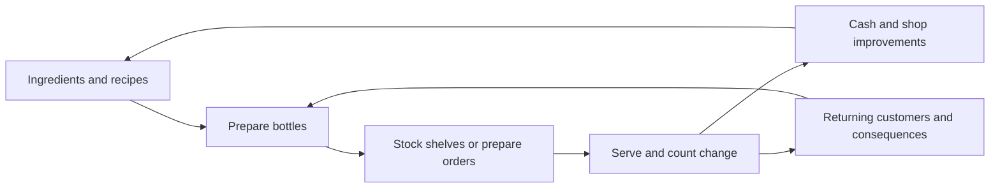

# Fantasy Shopkeeper — game design document

Version 0.1 · 2026-11-09 · Production planning draft

**Pitch:** Run a small fantasy potion shop. Make useful concoctions, arrange physical stock, serve customers by hand, and become part of their lives through what you choose to make and sell.

The project is now a serious game concept. The Godot prototype remains the playable reference for retail and Fen's encounter. This document defines the proposed production game; it does not claim that brewing, staff or the release content described here already exist.

## 1. Decisions and assumptions

| Status | Direction |
| --- | --- |
| User confirmed | Solo development; first-person fantasy shopkeeping; stocking and a little arithmetic are enjoyable; optional stories are worthwhile; pursue the game beyond the two-day experiment. |
| User confirmed | Stylised, richly lit 3D, using Tiny Glade and Kena as visual references. Their content scale and character-production budgets are not our targets. |
| User confirmed | Development PC: Ryzen 7 9800X3D, 32 GB RAM, RTX 5070 Ti. Moderate Unreal Blueprint experience; limited C++. |
| User constraint | Human-made art and as much AI assistance as platform rules permit, with a preference to avoid a Steam AI label. Current disclosure requirements still need official verification; manual art alone is not a guarantee. See [content provenance](content-provenance.md). |
| Existing design retained | Single player, Windows first, keyboard/mouse, relaxed pacing, manual totals/change, physical stock, ordinary trade viable, voluntary stories and recoverable financial trouble. |
| Recommendation | Make brewing the next major design exploration. Evaluate Unreal as the production engine before growing the Godot implementation. See [engine decision](engine-decision.md). |
| Proposed, not approved release commitments | The content envelope, crafting rules, progression and shipping save behaviour below. Validate these in a representative slice. No release date or advertised playtime is set. |

The old two-day/five-session limits describe the initial experiment. They are not a production schedule or a limit on the finished game. Existing prototype prices and loan amounts are test values.

## 2. Player experience and pillars

The player is a working local alchemist: part maker, part retailer, part familiar face behind the counter. A successful session has small satisfactions—bottles clicking into place, a batch finished, correct change counted—and a reason to wonder who will come in next.

1. **Pleasant physical work.** Making, carrying, arranging and handing over products should feel good before upgrades are added. Interactions prioritise clear aiming, stable placement, readable feedback and correction.
2. **Magic has a practical purpose.** Ingredients and recipes produce understandable effects. Customers need steady light, dependable ink or a tonic for an early start. Those needs give fantasy products meaning.
3. **A shop with relationships.** Returning customers remember events and have ordinary reasons to shop between story visits. Personal stories and the daily business influence each other.
4. **Time to think.** No income penalty for slow arithmetic, reading or considering an offer. Preparation, evening planning and pause remain unrestricted.
5. **Choose what deserves your attention.** Familiar recipes, tools and paid help can reduce repeated work. Ordinary manual business stays economically viable, and stories add opportunities without becoming compulsory progression gates.

The tone is warm, specific and gently funny. Characters have manageable problems and their own resources. A missed promise can matter locally without making the player responsible for catastrophe.

## 3. Audience, format and scope

The audience enjoys tactile shop simulators, cosy management, crafting and character-driven fantasy. Manual arithmetic is part of the default experience, with forgiving correction. The game should also be readable and approachable for players who take longer to process numbers or text.

The proposed first commercial release is a focused premium PC game with one primary shop, an adjoining workroom and a small authored local chapter. The wider town is expressed through customers, deliveries, sounds, letters and visible changes near the doorway. We do not need an explorable town to establish a community.

A **planning envelope** for estimating production is six recurring named customers, three short overlapping arcs, six to eight base recipes, eight to twelve ingredients, one brewing bench, a small set of shop upgrades and one mundane restocker. These are scope caps to cost and test, not promises to market. Recipe variants should be a few authored products rather than a combinatorial catalogue. Campaign length and any post-chapter business mode depend on measured pacing and content reuse.

Multiplayer, combat, ingredient-gathering expeditions, an open world, elaborate branching campaigns and fully simulated fluids are outside this baseline. Console support, full voice acting, extensive decoration and magical production machinery are later decisions.

## 4. The repeating day

**Preparation:** receive paid deliveries, inspect ingredients and finished stock, make batches, arrange shelves, set prices and review accepted orders. Start trading explicitly when ready.

**Trading:** serve a fixed allocation of customer opportunities. Customers browse available shelf stock, bring baskets to the counter and may offer an optional conversation or request. Work at the bench or restock between interactions. Progress follows resolved visits, including lost sales, rather than arithmetic speed.

**Closing:** stop new arrivals and finish the current obligations. The interface must distinguish unstarted visits that will be skipped from customers already being served. Repeated close actions cannot charge costs twice.

**Evening:** review takings, ingredient and stock costs, expenses, wages and debt. Order supplies for the following morning, plan batches, arrange paid help and change tomorrow's prices. Advancing the day is explicit.

Production may eventually present a visible queue, but waiting must not reduce payment, drive abandonment or remove customer opportunities. A larger crowd is a presentation and routing problem, not an impatience timer. There is no hidden sunset deadline while the player reads a story.

## 5. Brewing and products

### Everyday batches

Known recipes are the reliable foundation. A recipe specifies ingredients, quantities, a short ordered process and the resulting product. The player prepares ingredients at the bench, performs a small number of deliberate actions and bottles the result into real items that can be stocked, carried and sold.

The first brewing test should contain one station, a few ingredients and two recipes. Start with authored processes such as measuring, combining and finishing a brew. Each action needs a visible or audible explanation of what changed. Do not assume repeated stirring or waiting is enjoyable simply because it resembles brewing.

Known recipes should not fail because the player hesitates or reacts slowly. Any experimental action with material cost must be chosen knowingly. Experimental failures should be small and recoverable. Hidden chemistry puzzles, dexterity tests, real-time heat emergencies and hundreds of ingredient combinations are not requirements for the first slice.

A batch can eventually yield several equivalent bottles, making routine preparation more efficient while retaining meaningful ingredient costs. The first implementation should establish one correct input-to-output transfer before adding batch scale.

### Bespoke work

A customer describes a need. The player can ask for the relevant detail, select a known recipe or authored variation, agree clear quantity/price/collection terms and prepare suitable stock. “A steady light that won't attract moths” is a stronger starting point than “bring product ID light”.

An order can be satisfied by an existing bottle that genuinely meets its requirements; do not force wasteful remaking merely to mark it as bespoke. The interest comes from understanding the need and choosing what to prepare. Future variations might change stability, scent or appearance, but only when those differences have understandable effects and affordable authoring costs.

Accepted orders must state whether goods are being bought, donated or exchanged. Promises alone do not lock inventory. A collection shelf or reservation must be an explicit player action, with visible ownership and release rules. Missed orders have disclosed, proportionate consequences and permit an ordinary trading route afterwards.

### Supply

Buy ingredients and a limited range of finished staples through evening suppliers. Ingredient deliveries support brewing; finished staples can keep everyday retail moving while the player learns or takes on a specialist order. Core recipes and a viable ingredient supply must remain available through ordinary progression, even when story offers are declined.

For the first brewing slice, use fixed, legible supplier costs. Harvesting, combat drops, random ingredient quality and simulated spoilage would multiply the systems to balance and are deferred.

## 6. Physical stock and shared actions

A product is a kind of merchandise; an item is one physical unit. A batch creates a specified number of items once. Every item has one owner/location: delivery, storage, a shelf, an actor's hand, a customer basket or a completed departure. Money, materials and items must remain consistent across retries and reloads.

Pick-up and placement enforce reach, line of sight, carry capacity, compatible destinations and occupied spaces. Future restockers use the same action boundary as the player. Worker identity does not allow stock teleportation or hidden inventory shortcuts.

Begin with stable snap placement. Carrying crates and moving several bottles are likely useful improvements after validating the bench interaction. Freeform physics chaos is not a prerequisite for tactility. Placement should support undo or correction where it can be done without duplicating goods.

Prepared bottles need a readable product identity, recipe/output data and any actual effect variation. Avoid per-bottle statistics that never affect a player decision. Distinct silhouettes, labels and symbols should convey identity alongside colour and glow.

## 7. Customers, checkout and prices

Ordinary customers arrive with modest, understandable baskets. They buy available shelf stock and can reject an unreasonable price. Delivery stock that has not been put out for sale remains unavailable. Missing-stock reactions are immediate; the initial design does not add an automatic persistent lost-sales report.

The default checkout remains manual: read individual prices, enter the basket total, receive payment, dispense change and confirm. Bits, marks and crowns have values 1, 10 and 100. Any correct combination works. Click/hold dispensing, keyboard alternatives, tray correction and leaving/returning must preserve a pending transaction.

Price expectations should be explainable through products and customers. The prototype's twice-initial-price rejection threshold is a test rule, not a finished demand model. Begin with stable ranges before considering fluctuating markets or personalised willingness-to-pay.

Proposed accessibility options include a readable notebook, adjustable text/UI scale, clear denomination shapes and an optional arithmetic aid. Manual calculation stays the default. Assistance must not introduce waiting penalties or shame players for using it; exact aid behaviour needs a separate interaction test.

## 8. Stories and recurring characters

Use the [story strategy](story-strategy.md) as the narrative foundation. Short arcs generally span two to four visits: establish a person through trade, offer an opportunity where appropriate, show an outcome, then let them shop normally again. Shared local events can connect arcs without turning every declined request into a blocked chain.

Stories can involve a product promise, a shop display choice, advice, an unusual application of a recipe or an uneventful returning regular. Meaningful effects include a changed basket, a visible object, a remembered detail or an optional commercial opportunity. Essential staff, core recipes and basic recovery must not require story participation.

Fen's existing encounter demonstrates optional delivery and a visible consequence through normal trade. It currently accepts an off-the-shelf starlight bottle. The production brewing slice should explore a suitable recipe/effect choice for that need, while keeping the request voluntary and the transaction honest. This is a proposed reworking, not a crafting feature already present.

Player-facing dialogue, item descriptions and localisation intended for release need human authorship and provenance under the stated AI policy goal. Prototype dialogue is a placeholder for that production process; see [content provenance](content-provenance.md).

## 9. Economy and progression

Manual operation must cover ordinary business costs at sensible prices. Income competes with ingredients, finished stock, daily expenses, wages and upgrades. The value of an order should include material cost and worthwhile compensation for the work, without making optional stories the only profitable customers.

Use a transparent recovery loan to fund roughly one or two days of basic supplies when the shop cannot continue. State principal, total repayment and conditions before acceptance. Debt is a recoverable obligation, with no compounding trap or forced bankruptcy/replay. The current 112/118 terms are prototype tuning values.

Proposed progression moves from a modest counter and bench to better storage, more reliable batch tools, a mundane helper and a personalised specialist shop. Improvements should change work visibly. Recipe access can grow through paid learning and regular suppliers; story discoveries may offer alternatives and distinctive applications.

A restocker's wage must be disclosed and paid for a stated period. They move real stock, retry changed targets and pause safely when the player occupies a route or destination. Later magical machinery needs explicit purchase/maintenance costs and different strengths so a mundane employee remains useful.

With unlimited thinking time and fixed customer opportunities, faster work does not automatically create more money. Delegation's first value is comfort and freedom to concentrate on making, customers or conversation. Test whether that freedom feels worth the wage rather than adding artificial urgency to justify staff.

## 10. Presentation, input and accessibility

The selected visual direction is **stylised, richly lit 3D**. Use warm wood, readable glass, restrained metallic detail, soft shapes, strong product silhouettes and carefully composed magical light. Morning/evening lighting can change at explicit day transitions, preserving relaxed pacing. See [art direction](art-direction.md) for concrete references and a representative scene.

Sound should make work legible: a bottle seats, a measure fills, a process changes state, a coin lands. Ambient shop and street sounds can imply the town. Full voice acting is not required for the first release scope. Music should support a calm working rhythm without turning every event into a quest announcement.

Maintain first-person keyboard/mouse controls with sensitivity, remapping, readable prompts and a useful pause. Avoid mandatory camera shake, flashing effects or colour-only recipe information. Text advances at the player's pace; a story can be deferred. Controller support is a later production decision rather than a claim based on engine compatibility alone.

## 11. Persistence and technical design

The prototype saves morning checkpoints and intentionally rolls the whole day back on restart. A production **save-and-quit** that preserves the current phase and pending work is a proposed shipping goal, with the morning checkpoint retained as a separate recovery option. It is not implemented yet and needs explicit scope in the vertical slice.

Saves must preserve ingredient quantities, batch progress, items and ownership, baskets, payment/change, finances, orders, staff obligations and story decisions coherently. Writes occur around atomic transactions; restoring must never replay a debit, delivery, brew output or story reward. Include schema versions and validation. Invalid saves must not be silently replaced.

Keep recipes, product data, customer schedules and arc definitions separate from scene presentation. Centralise economic commits, ownership transfers and story resolutions. Rendering and dialogue widgets observe those results rather than granting rewards or consuming stock independently. These principles apply in either engine; existing GDScript tests are behavioural references and will not automatically run in Unreal.

## 12. Production plan and decisions

1. **Design/engine decision:** choose the visual reference direction (now selected), resolve content-policy questions, and run the bounded Unreal evaluation in engine-decision.md. Preserve the Godot checkpoint.
2. **Representative brewing slice:** one coherent room, one bench, two recipes, one normal batch and a made-to-order interpretation of Fen's need. Complete stocking and manual checkout in the chosen engine; package on Windows.
3. **Production foundation:** stable data/ownership model, saves, supplier flow, a representative returning customer and human-authored content workflow. Prove that a second recipe and encounter can be added without rebuilding the system.
4. **Attention and progression:** one mundane restocker, a small set of storage/batch upgrades and a short local chapter. Verify that ordinary trade alone funds this route.
5. **Content and release:** complete the chosen content envelope, accessibility, performance, Windows QA, store materials and accurate policy/asset disclosures. Set advertised length only after testing.

A proposed first-release envelope is intentionally small; do not multiply recipes, characters and branches to create an artificial campaign length. The developer must be able to author and maintain the game alone.

Success criteria for the next slice: brewing feels worthwhile over repeated batches; players understand the bespoke request and its cost; story engagement remains optional; the shop reaches the intended look at an acceptable packaged framerate; and authoring the next product/customer is sustainable. The prior prototype supports retail and one encounter. It does not yet validate brewing, production visuals, staff value, long-term retention or commercial demand.

Open production decisions: actual minimum hardware, release chapter length, order reservation/deposit rules, recipe experimentation depth, scope of mid-day saves, controller support, art budget/sourcing, current Steam AI disclosure requirements and final engine version. Engine recommendation and art direction are now specific enough to evaluate without resolving all of those at once.
